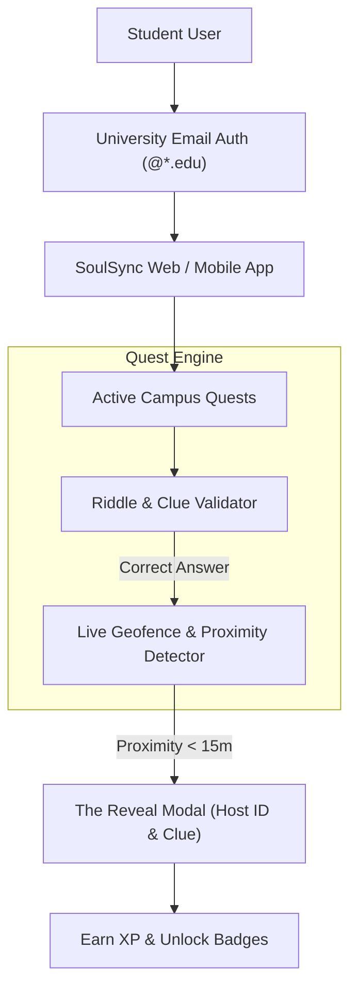

# SoulSync — Fostering Student Connections

> **"Adventure Over Algorithm"** — A Gamified Solution to Student Disconnection  
> **Authors & Creators**: Tanmayi Nagabhairava & Dharshini V.

---

## 🌟 Abstract

**SoulSync** is a location-based social adventure platform created to tackle student loneliness and social anxiety on university campuses. Rather than relying on superficial profile swiping, algorithmic matching, or awkward cold direct messages, SoulSync turns the physical campus into a collaborative adventure. 

The platform replaces passive digital screen time with active, real-world **Quests** — gamified riddles and puzzles leading to designated, safe physical meetup spots. By providing a natural, shared purpose to meet, SoulSync eliminates social friction, guarantees campus safety through mandatory university email verification and public geofencing, and fosters genuine friendships rooted in real experiences.

---

## 🎯 The Core Problem

Despite being surrounded by thousands of peers every day, college students experience acute social disconnection:
1. **Social Anxiety**: The initial fear and awkwardness of initiating conversations with unfamiliar peers.
2. **Lack of Common Ground**: Difficulty discovering others with shared niche interests or study goals without forced introductions.
3. **Digital Isolation**: Students are physically co-located in classrooms and cafeterias, yet socially isolated behind their smartphone screens.

### Why Existing Solutions Fail
Current social platforms (chat groups, dating/friendship apps) emphasize direct messaging and profile browsing. They do not solve the fundamental friction: **creating a comfortable, organic reason to interact in the physical world**.

---

## 💡 The SoulSync Solution: "Adventure Over Algorithm"

SoulSync believes that **a shared journey is a significantly stronger foundation for friendship than an arbitrary algorithm**. Solving a riddle together creates camaraderie, laughter, and an instant topic of conversation.

### Key Pillars

1. **Riddle-Based Quests**:
   - Hosts broadcast micro-events (study sprints, casual chai, hackathon brainstorming, sports).
   - The meetup coordinate is shrouded behind a contextual clue or puzzle with adjustable difficulty.
   - Solving the puzzle unlocks the GPS coordinate.

2. **Live Map & Anonymized Radar**:
   - A dynamic, interactive map of the campus displays active quests.
   - Participants see anonymized avatars and participant counts moving toward the beacon in real time.

3. **"The Reveal" (Overcoming Meetup Friction)**:
   - When participants enter the geofenced perimeter (within 15–20 meters), the app triggers "The Reveal".
   - The host's identity, avatar, and an unmistakable physical identification clue (e.g., *"wearing a navy blue hoodie, sitting on the corner wooden bench with a red thermos"*) are revealed.
   - This eliminates the awkwardness of pacing around looking for someone you haven't met.

4. **Safety by Design**:
   - **Institutional Email Verification**: Mandatory `@*.edu` authentication ensures all participants are verified university students.
   - **Safe Public Geofencing**: Meetups are restricted strictly to pre-approved, well-lit, public campus areas (libraries, dining halls, main lawns, quadrangle).

5. **Gamification & Campus Economy**:
   - Students earn Experience Points (XP), level progressions, and achievement badges for hosting and completing quests.
   - Unlocked achievements can partner with campus canteens and bookstores for student perks.

---

## 🏛️ System Architecture

---

## 🔮 Future Roadmap

1. **Orientation Integrations**: Deploy SoulSync during freshman orientation weeks to help incoming students quickly build peer networks.
2. **Multi-Stage Campus Scavenger Hunts**: Allow campus clubs and student bodies to host multi-stop puzzle trails.
3. **Campus Business Partnerships**: Partner with campus cafes and university bookstores for discounts redeemable with quest XP.
4. **Cross-Campus Expansion**: Scale the verified geofenced model across other universities and collaborative innovation hubs.
